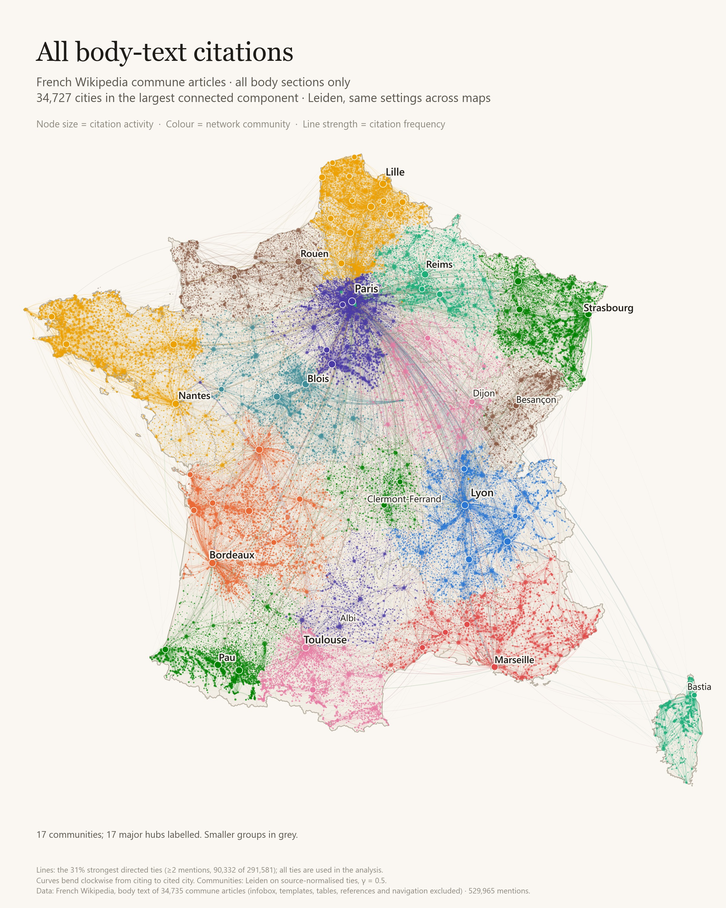
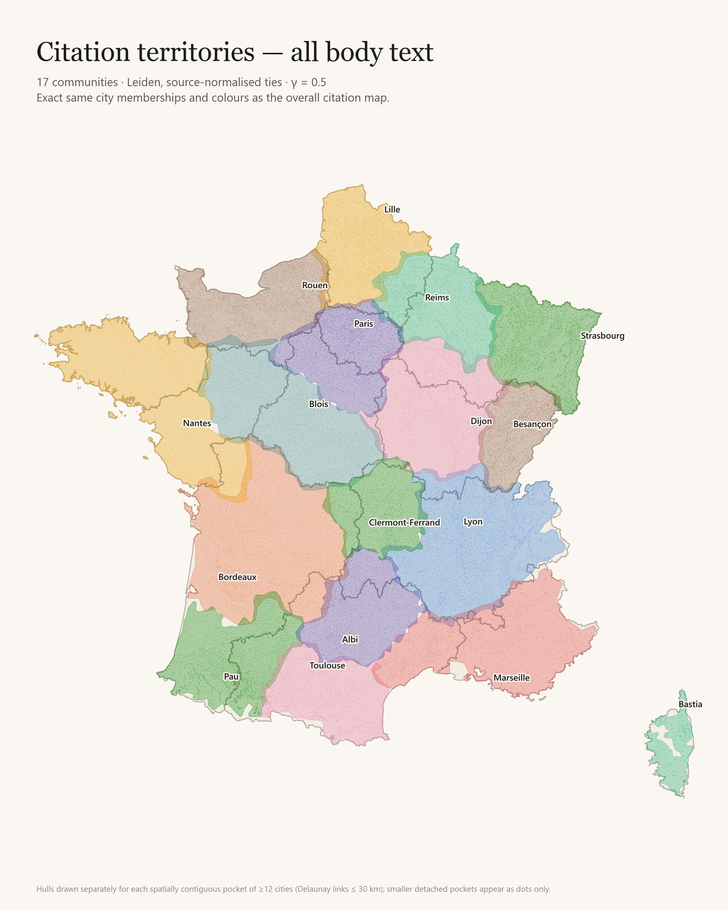
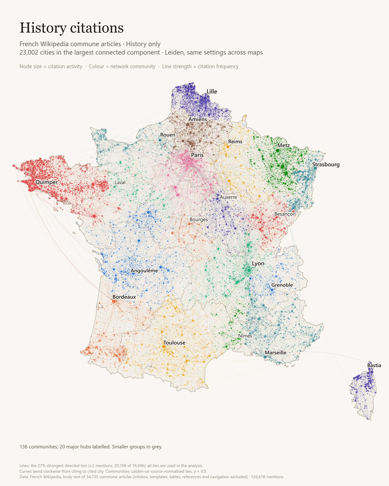
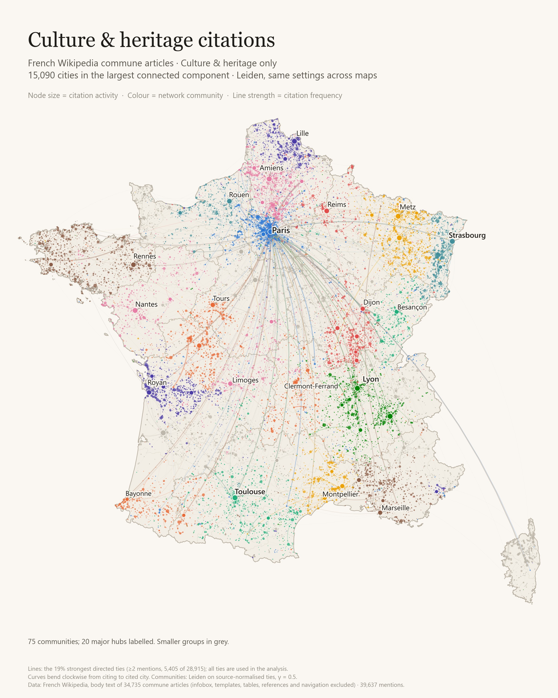
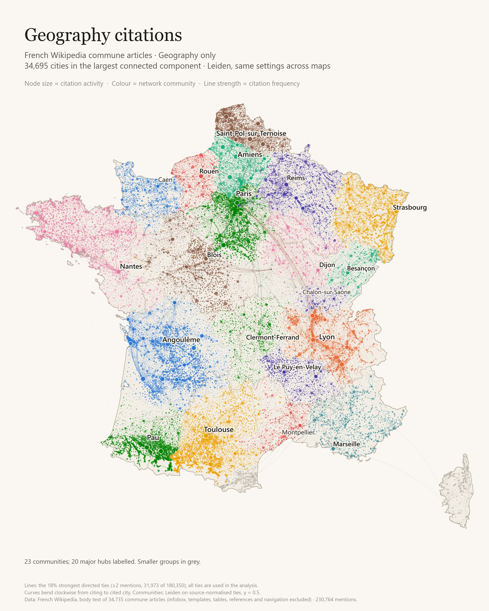
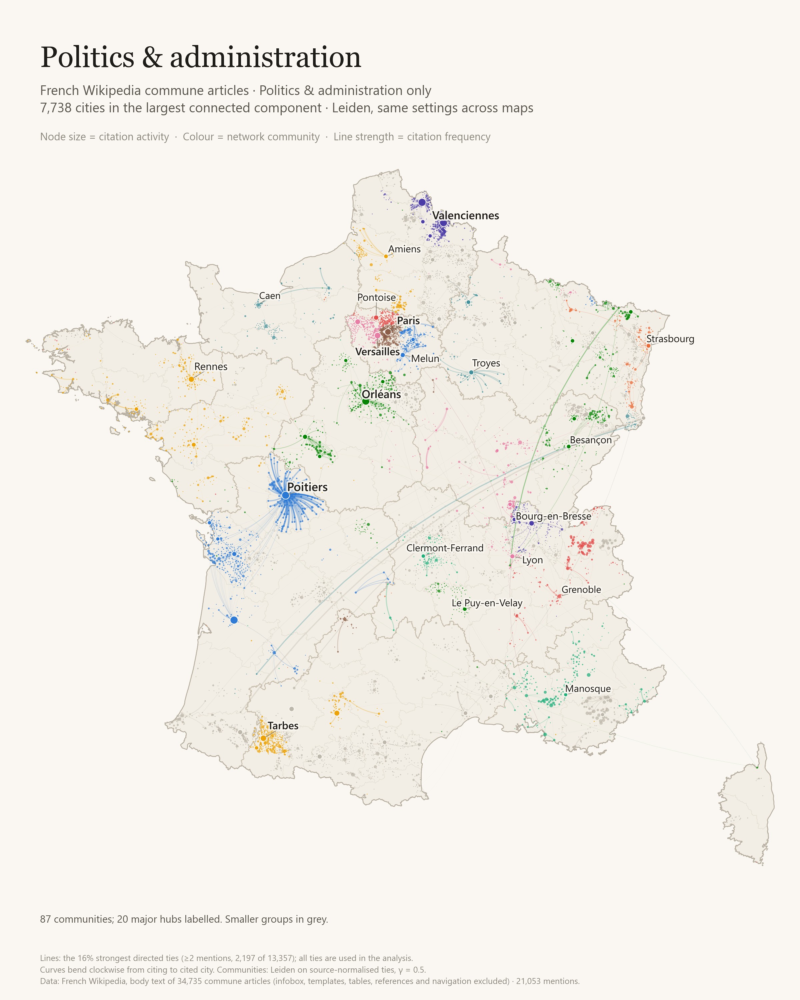

# Wikipedia commune citation networks

Which French communes does Wikipedia mention when it writes about another one?
This project turns every mention of a commune inside another commune's French
Wikipedia article into a weighted, geographic network, clusters it, and draws it
as a map. It produces five views: **all body text, history, culture and
heritage, geography, politics and administration**.

Full results: [HTML report](report/index.html) · [PDF](report/citation_report.pdf)

## The maps

Each map places communes at their real coordinates. Dots are sized by how often
a commune is cited, lines are ties of at least two mentions, and colours are the
clusters found by the algorithm. Colours are independent across maps.

### All body text



The same 17 clusters drawn as territories:



### History



### Culture and heritage



### Geography



### Politics and administration



## Results

| Layer | Mentions | Active cities | Groups | Median km | Seed ARI |
|---|---:|---:|---:|---:|---:|
| All body text | 529,965 | 34,727 | 17 | 9.7 | 0.731 |
| History | 126,618 | 23,822 | 136 | 11.8 | 0.749 |
| Culture and heritage | 39,637 | 17,005 | 75 | 11.4 | 0.884 |
| Geography | 230,764 | 34,697 | 23 | 8.6 | 0.753 |
| Politics and administration | 21,053 | 10,677 | 87 | 9.8 | 0.933 |

- 529,965 mentions connect 34,727 communes. The median mention spans 9.7 km and
  87.8% span less than 50 km: communes mostly cite their neighbours.
- Geography sections are the most local (8.6 km median); history and culture
  reach further (about 11 to 12 km).
- Paris is an endpoint of 1.7% of all mentions, 1.8% in history and 4.6% in
  culture. This measures textual prominence, not real-world importance.
- Cluster counts differ strongly between topics because each network is fitted
  independently, and density and connectivity affect those counts.

Numbers are generated from the data; see `report/section_summary.csv`.

## Method

1. **Corpus.** The highest locally stored revision of each commune article
   (metropolitan France). Revision IDs are kept in `cache/pages.parquet`. This
   is a mixed-date local corpus, not a synchronized snapshot.
2. **Commune identity.** Articles are mapped to INSEE codes validated against
   official reference data (COG 2025). Delegated and associated communes fold
   into their parent. Overseas communes, non-communes and self-citations are removed.
3. **Extraction.** Infoboxes, templates, tables, images, references, comments
   and end matter are stripped. A mention is a resolved commune wikilink plus
   plain-text repeats of that name, anchored by at least one link in the same
   article. Ambiguous names, names under three characters, a stoplist and names
   contained in the source commune's name are excluded from repeats.
4. **Topics.** Mentions are assigned by level-2 section heading using the
   ordered keyword list in `section_groups.py` (first match wins, subsections
   inherit their parent). Topic maps overlap; they are not a partition.
5. **Weights.** For each layer, `w_ij = n_links + n_text`, normalized by source:
   `p_ij = w_ij / sum_j(w_ij)`.
6. **Clustering.** Leiden `RBConfigurationVertexPartition` on the undirected
   projection `p_ij + p_ji` of the largest connected component, resolution
   gamma = 0.5, five seeds, highest objective retained. Stability is the mean
   pairwise adjusted Rand index across seed pairs. Administrative boundaries
   are not used to fit clusters.
7. **Maps.** 2400 x 3000 renders with great-circle distances weighted by
   mentions; coverage of the largest component is reported for each layer.

## Rebuild

With Python 3.12 or later (tested with 3.14.2), from this folder:

```powershell
python -m venv .venv
.venv\Scripts\Activate.ps1
python -m pip install -r requirements-dev.txt
python section_maps.py
python scripts/validate_report.py
ruff check .
python -m unittest discover -s tests -v
```

Parsed inputs and reference snapshots are committed, so no raw corpus or
network access is needed. Add `--svg` for vector maps, `--render-only` to
redraw without refitting clusters. Outputs are `report/` (HTML, PDF, maps, node
and edge tables, `section_report.json` with input hashes and library versions).

To rebuild from raw wikitext, place the corpus in the parent folder
(`content_wikitext/` and `page view/tables/pages_meta.csv`), then run
`fetch_reference.py`, `extract_links.py` and `section_maps.py`.
`analysis.py`, `who_cites_whom.py` and `template_audit.py` hold the extended analysis.

## Limits

"Citation" means a mention of another commune, not a bibliographic reference.
Plain-text repeats can refer to people or homonyms, and citation geography does
not establish travel, influence or causality. See [CODE_REVIEW.md](CODE_REVIEW.md).

## Data and licence

Wikipedia-derived data retain upstream attribution and licensing requirements.
Reference data: INSEE COG 2025, geo.api.gouv.fr and France-GeoJSON department
outlines (IGN Admin Express, Licence Ouverte). No new software licence is asserted.
